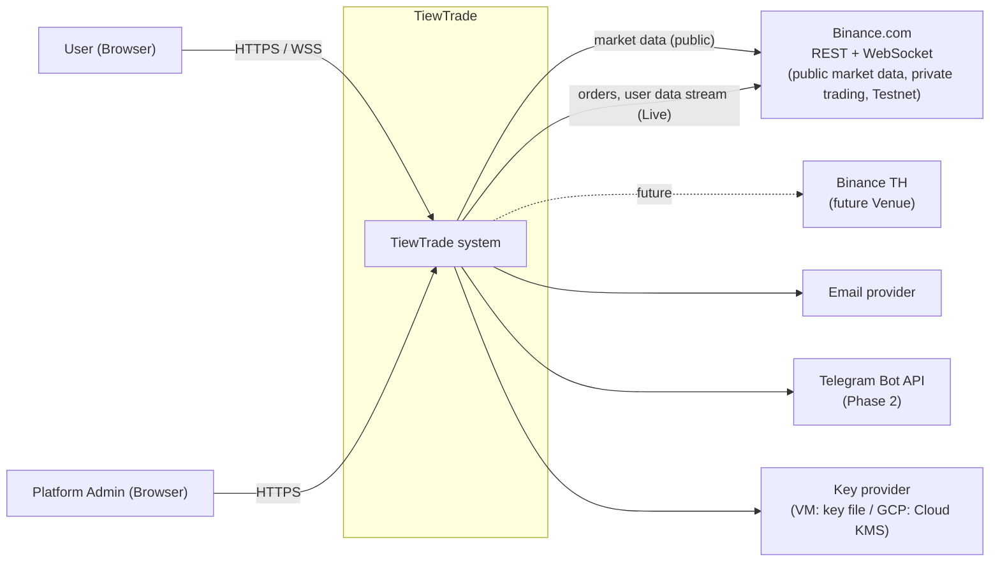
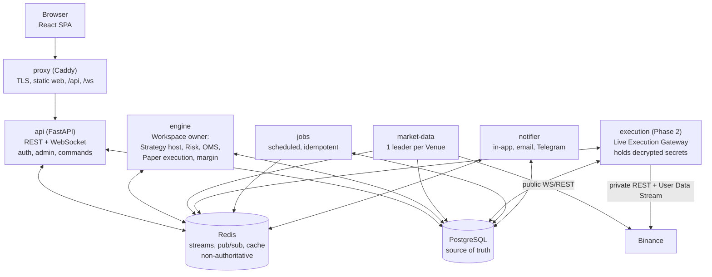
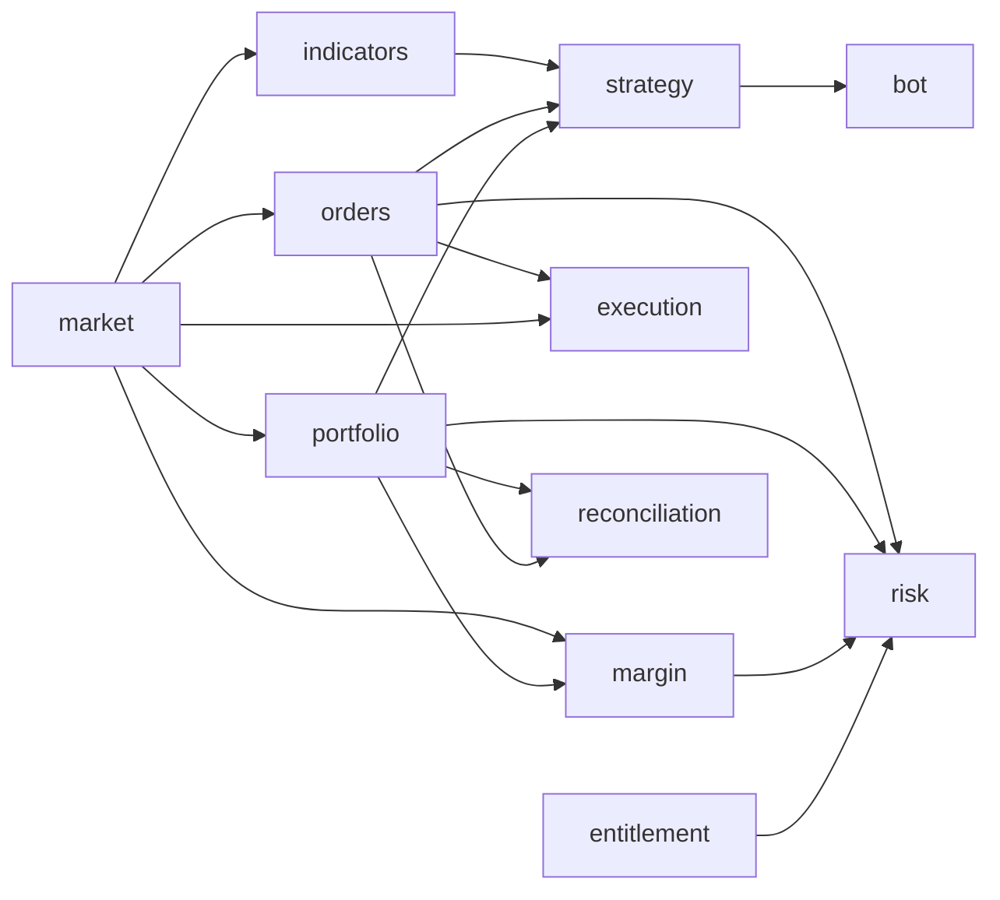
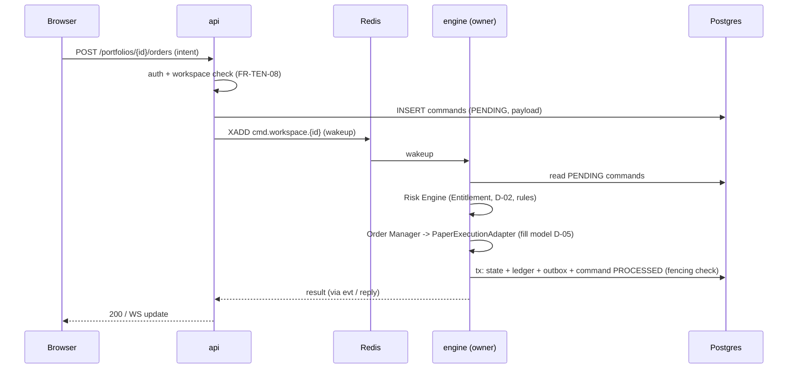
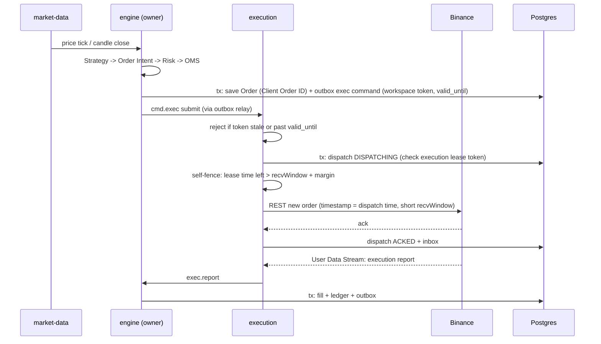
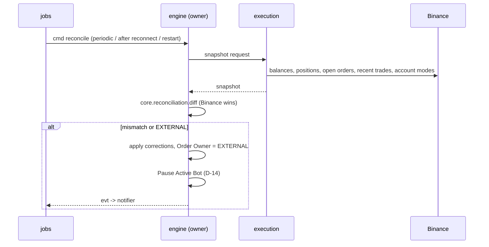
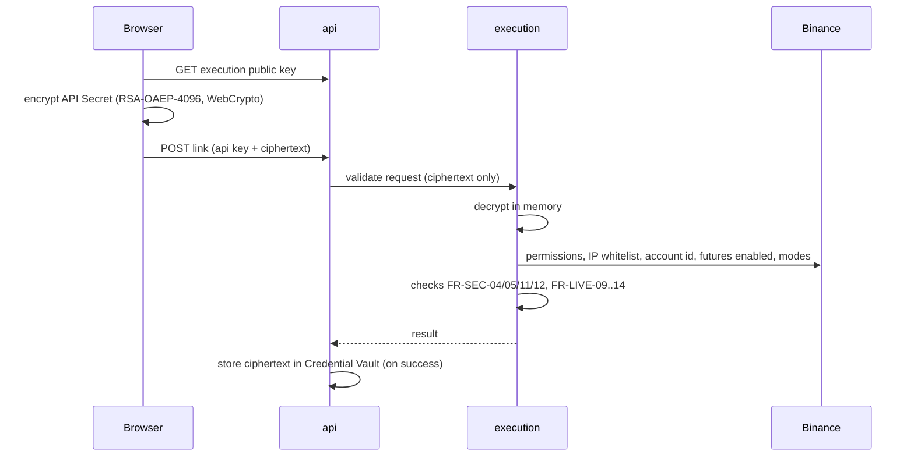

# TiewTrade — Architecture

| Field | Value |
|---|---|
| Status | **v0.3** — ADR 0001–0013 **Accepted** (2026-09-22) |
| Date | 2026-09-22 |
| Based on | [MVP Requirements v0.22](../requirements/mvp.md) |
| Scope | Process model, Trading Core module design, messaging & state, key flows, security, frontend, repo layout, deployment (VM → GCP), testing strategy |
| Out of scope | Data model / schema, API spec, calculation spec, implementation |

> **หลักการอ่าน**
> - อ้าง requirement ด้วย ID จาก mvp.md (P-xx, FR-xx, NFR-xx, D-xx) ไม่คัดลอกเนื้อหาซ้ำ
> - Domain term ใช้ตาม [Glossary](../requirements/mvp.md#6-domain-glossary-ubiquitous-language)
> - การตัดสินใจหลักอยู่ใน [ADR](adr/) สถานะ **Accepted**; การเปลี่ยนแปลงต้องทำเป็น ADR ใหม่ที่ supersede ฉบับเดิม
> - Code ในเอกสารนี้เป็น **pseudo-code ระดับ interface** เพื่ออธิบายขอบเขต ไม่ใช่ implementation

---

## 1. Architectural Drivers

| Driver | ที่มา | ผลต่อ architecture |
|---|---|---|
| ทุก Order ผ่าน Risk Engine + Order Manager, Strategy ไม่เรียก Binance | P-01, P-02 | Strategy ส่งออกได้แค่ Order Intent; มีเส้นทางส่ง Order เส้นเดียว |
| Paper / Live ใช้ Trading Core ร่วมกัน ต่างแค่ adapter | P-03, P-04 | Trading Core แบบ hexagonal; `ExecutionAdapter` port เดียว 2 implementation |
| Margin / Liquidation ระดับ Portfolio, deterministic | P-05, P-07 | Portfolio เป็นหน่วยของ state และความสอดคล้อง (consistency boundary) |
| Binance เป็น Source of Truth + Reconciliation | P-08, P-09 | Live state มาจาก User Data Stream + snapshot; มีตัว diff ใน core |
| Credential isolation | P-10, FR-SEC-02 | Secret ถอดรหัสได้ที่ process เดียว (`execution`) |
| Active Bot ครั้งละ 1 ตัวต่อ Portfolio | D-02 | Bot อยู่ภายใน Portfolio ไม่ต้องมีกลไกแบ่ง Position ระหว่าง Bot |
| ราคาระหว่างแท่ง ≤1/วินาที, latency ≤1 วินาที (p95) | D-18, FR-STR-17, NFR-12 | engine เป็น event-driven, state อยู่ในหน่วยความจำและมีสำเนาใน Postgres |
| VM เดียวก่อน แล้วย้าย Cloud Run + Cloud SQL | NFR-19..25 | แยก process, lease + fencing, idempotent jobs, ไม่มี local state |
| รองรับ Binance TH ภายหลัง | D-17, FR-LGL-02/03 | Exchange Venue เป็น parameter ของ adapter และ market data |

---

## 2. System Context



---

## 3. Processes (Containers)

แยก process ตามหน้าที่ตั้งแต่รันบน VM เดียว (NFR-19) สื่อสารกันผ่าน Redis / Postgres เท่านั้น (NFR-20)



| Process | หน้าที่ | Instance / ความเป็นเจ้าของ | ห้ามทำ |
|---|---|---|---|
| **proxy** | TLS, เสิร์ฟ static ของ `web`, route `/api` `/ws` ไป api | 1 | — |
| **api** | REST + WebSocket ไปหน้าจอ, auth / 2FA, admin API (FR-ADM), อ่านข้อมูล, บันทึก **command** ลง Postgres แล้วแจ้งเจ้าของ Workspace ([ADR-0011](adr/0011-durable-command-lifecycle.md)), fan-out event ไปหน้าจอ | หลายตัวได้ (stateless) | แก้ state ของ Portfolio เอง, เห็น API Secret |
| **engine** | เจ้าของ Workspace (ทุก Portfolio ของ Workspace): host Strategy ของ Active Bot, Risk Engine, Order Manager, Paper Execution Adapter, margin / liquidation, Open Notional, paper replay หลังล่ม | หลายตัวได้; **Workspace หนึ่งมีเจ้าของตัวเดียว** ด้วย lease + fencing (NFR-21, [ADR-0009](adr/0009-workspace-single-writer.md)) | เรียก Binance ตรง, ถือ Secret |
| **market-data** | รับ public stream (kline, bookTicker, markPrice, funding) ต่อ Venue, สร้าง / บันทึก Candle, รวบราคา ≤1/วินาที/Symbol (FR-STR-17), backfill ช่องว่าง | **1 leader ต่อ Venue** | — |
| **execution** | ถอดรหัส Secret, ส่ง Order / Cancel, User Data Stream ต่อบัญชี, snapshot ให้ Reconciliation, ตรวจ Key ตอนเชื่อม (D-04), global rate limiter (NFR-07) | lease ต่อบัญชี Binance | รัน Strategy, ตัดสิน Risk |
| **jobs** | งานตามรอบแบบ idempotent: trigger Reconciliation, retention cleanup (NFR-18), paper funding fee, ส่ง outbox ที่ค้าง; รันเป็นคำสั่ง CLI ได้ (NFR-22) | ตามรอบ | — |
| **notifier** | แปลง event เป็นการแจ้งเตือนตาม preference, ส่ง In-app / Email / Telegram, กันส่งซ้ำ (FR-NTF) | หลายตัวได้ | — |
| **postgres** | Source of truth ภายใน: state, ledger, outbox, lease, candles, audit log | 1 | — |
| **redis** | Streams (command / event), pub/sub ราคาไปหน้าจอ, latest price, rate-limit bucket | 1 | เป็นที่เก็บข้อมูลหลัก |

**ทำไม engine กับ execution แยกกัน:** engine รัน Strategy และประมวลผล event จำนวนมาก ส่วน execution ถือ Secret ที่ถอดรหัสแล้ว การแยก process ทำให้ bug หรือช่องโหว่ใน engine เข้าถึง Secret ไม่ได้ และจำกัดสิทธิ์ถอดรหัสไว้ที่ service account เดียวบน GCP ([ADR-0005](adr/0005-live-execution-gateway-and-credentials.md)) ต้นทุนคือ hop ผ่าน Redis เพิ่มระดับมิลลิวินาที ยังอยู่ในเป้า NFR-12

---

## 4. Trading Core (`tiewtrade_core`)

### 4.1 หลักการ ([ADR-0001](adr/0001-hexagonal-pure-trading-core.md))
- **Pure Python** ไม่มี I/O: ไม่เรียก network, database, Redis, filesystem
- **ไม่อ่านนาฬิกาเอง:** เวลาทุกอย่างมากับ event ที่ป้อนเข้า → ผลลัพธ์ deterministic, replay ได้ (NFR-15), ทดสอบซ้ำได้ผลเดิม (FR-STR-13)
- **Decimal** ทุกค่าที่เป็นเงิน / ราคา / จำนวน (FR-MRG-08, NFR-04)
- **ไม่ import** FastAPI, SQLAlchemy, Redis, httpx และ package ของ services — บังคับด้วย import-linter ใน CI
- ใช้ stdlib เป็นหลัก ไม่มี dependency ภายนอกใน core

### 4.2 Modules



| Module | ความรับผิดชอบ | Requirement |
|---|---|---|
| `market` | Venue, Market Type, Symbol, Symbol Filters, Candle, Timeframe, price / mark / funding events, การปัดเศษตาม filters | FR-MKT, FR-LGL-03 |
| `indicators` | Volume, SMA, EMA, Bollinger Bands, RSI, MACD, ATR แบบ incremental + **test vectors** (JSON) ที่ frontend ใช้ร่วม | FR-CHT-03, FR-CHT-06 |
| `portfolio` | Wallet, Position (Portfolio, Symbol, Position Side), Position Episode และ Attribution (FR-PF-11), apply Fill / Fee / Funding / Transfer / Virtual Deposit, Realized / Unrealized PnL, Open Notional | FR-PF, FR-ACC-08..11, FR-PLN-04 |
| `margin` | Initial / Maintenance Margin, Leverage Bracket, Margin Ratio, Liquidation Price (cross / isolated, One-way, Single-Asset) | FR-MRG, D-03 |
| `orders` | Order Intent, Order, Bracket (Entry / TP / SL) พร้อมกติกา partial fill และ fail-safe (FR-ORD-14..17), state machine, Order Owner, **Client Order ID scheme** | FR-ORD, FR-MAN, D-14 |
| `risk` | Risk Engine: Entitlement (Leverage, Open Notional, Live), Portfolio Risk Rules, กติกา Active Bot / Manual (D-02), Kill Switch, Global Kill Switch, Symbol status, Trading Restriction (FR-LIVE-19) | FR-RSK, FR-PLN, FR-ADM-06 |
| `execution` | port `ExecutionAdapter` + `PaperExecutionAdapter` (Paper Fill Model) + trigger TP / SL / liquidation ของ Paper | FR-ORD-06..13, FR-MRG-05 |
| `strategy` | Strategy interface, Strategy Context (read-only), Parameter Schema + validation, clamp Leverage ตาม Plan | FR-STR, FR-PLN-07 |
| `bot` | Bot lifecycle (`RUNNING` / `PAUSED` / `STOPPED` / `ERROR`), pause reasons, Active Bot | FR-STR-09/10, D-02 |
| `reconciliation` | เทียบ internal state กับ exchange snapshot → corrective events (Binance ชนะ), ตรวจ `EXTERNAL`, ตรวจโหมดบัญชี | FR-LIVE-04..06, FR-LIVE-12 |
| `entitlement` | ค่า Entitlement ของ Plan (อ่านจาก config ที่ส่งเข้ามา) และการประเมินส่วนเกิน | FR-PLN-03..12 |

`tiewtrade_strategies` (package แยก) เก็บ Built-in Strategy ที่เจ้าของระบบเขียน ขึ้นกับ `tiewtrade_core` เท่านั้น (D-06)

### 4.3 Key interfaces (pseudo-code)

```python
# strategy — ส่งออกได้แค่ Order Intent (P-01)
class Strategy(Protocol):
    parameter_schema: ParameterSchema          # FR-STR-11
    version: str                               # FR-STR-12
    def on_candle_close(self, ctx: StrategyContext, candle: Candle) -> list[OrderIntent]: ...
    def on_price(self, ctx: StrategyContext, tick: PriceTick) -> list[OrderIntent]: ...   # optional (FR-STR-16)

# StrategyContext: read-only view — params, indicators, position, balances, open orders, now (จาก event)

# execution — port เดียว ใช้ทั้ง Paper และ Live (P-03, P-04)
class ExecutionAdapter(Protocol):
    def submit(self, order: Order) -> None: ...          # ผลลัพธ์กลับมาเป็น ExecutionReport event
    def cancel(self, order_id: ClientOrderId) -> None: ...

# risk
class RiskRule(Protocol):
    def check(self, intent: OrderIntent, view: RiskView) -> RiskCheckResult: ...   # APPROVED / REJECTED + reason

# portfolio — pure state transition
def apply(state: PortfolioState, event: PortfolioEvent) -> tuple[PortfolioState, list[DomainEvent]]: ...
```

`PaperExecutionAdapter` อยู่ใน core เพราะเป็นการคำนวณล้วน (Paper Fill Model, D-05) ส่วน `BinanceExecutionAdapter` อยู่ใน engine และส่ง command ไป process `execution`

### 4.4 Client Order ID
- รูปแบบ: prefix ของระบบ + เวอร์ชัน + รหัส Portfolio แบบสั้น + ลำดับ (เช่น `ft1-<portfolio>-<seq>`) ความยาวไม่เกินที่ Binance กำหนด (ต้อง verify)
- ใช้ทั้ง idempotency (NFR-05) และแยก Order ของระบบออกจาก `EXTERNAL` (D-14)
- สร้างก่อนส่งและบันทึกลง Postgres ก่อนส่งเสมอ เมื่อ timeout ให้ query ด้วย ID นี้ก่อน retry (FR-LIVE-07)

---

## 5. Workspace Engine (runtime model)

- ใน engine แต่ละ **Workspace** เป็นหน่วยประมวลผลแบบลำดับเดียว: event ของทุก Portfolio ใน Workspace เดียวกันถูกประมวลผลตามลำดับใน loop เดียว จึงไม่มี race ภายใน Portfolio และไม่มี race ในการตรวจวงเงิน / Leverage / จำนวน Portfolio ระดับ Workspace ([ADR-0009](adr/0009-workspace-single-writer.md))
- **วงเงิน:** Risk Engine คำนวณ Projected Open Notional จาก state ของทุก Portfolio ใน Workspace รวม Order ค้างทุกตัว วงเงินจึงถูกจองเมื่อบันทึก Order และคืนเองเมื่อ Order ถูกยกเลิก / หมดอายุ / fill (Calculation §5.2)
- **Input ของ Workspace:** commands (`commands` ใน Postgres + `cmd.workspace.{id}` ใน Redis เป็นตัวปลุก), market events ของ Symbol ที่เกี่ยวข้อง, execution reports, timers
- **Pipeline:** event → `portfolio.apply` / margin update → (Paper) trigger TP / SL / liquidation → Strategy callbacks → Order Intents → Risk Engine → Order Manager → ExecutionAdapter
- **Persist ก่อน publish:** state change + ledger + outbox เขียนใน transaction เดียว แล้วค่อย publish ([ADR-0003](adr/0003-postgres-state-ledger-outbox.md))
- **Ownership:** engine ได้ Workspace มาด้วย lease ใน Postgres ที่มี fencing token ทุกการเขียนตรวจ token (`... WHERE fencing_token = :t`) ป้องกัน engine เก่าที่ยังไม่รู้ว่าเสีย lease เขียนทับ ([ADR-0002](adr/0002-portfolio-single-writer-engine.md), [ADR-0009](adr/0009-workspace-single-writer.md)); command ที่ส่งไป execution มี token ของ Workspace เพื่อให้ execution ปฏิเสธ command ล้าสมัย ([ADR-0010](adr/0010-execution-dispatch-fencing.md))
- **Recovery:** เมื่อได้ lease โหลด state จาก Postgres → ประมวลผล command ที่ยัง `PENDING` ของ Workspace (ADR-0011) → (Paper) replay ช่วงที่หายด้วย Candle 1m ตาม NFR-15 → (Live) ขอ Reconciliation ก่อน resume Bot ตาม NFR-14

---

## 6. Messaging & State

### 6.1 Postgres (source of truth ภายใน)
| กลุ่มข้อมูล | รูปแบบ |
|---|---|
| Portfolio state | ตาราง state ปัจจุบัน (balances, positions, orders, bot) |
| Ledger | append-only: fill, fee, funding, transfer, virtual deposit, liquidation, external — ใช้คำนวณ Analytics และตรวจสอบย้อนหลัง |
| Commands / Outbox / Inbox | command จาก api / jobs และ message ที่ต้องประมวลผลแน่นอนบันทึกใน Postgres ก่อน; outbox `published_at` = ส่งเข้า Redis แล้ว; ผู้รับบันทึกการประมวลผลใน inbox ใน transaction เดียวกับผล ([ADR-0011](adr/0011-durable-command-lifecycle.md)) |
| Execution dispatch | แถว dispatch ก่อนส่ง request ไป Binance ([ADR-0010](adr/0010-execution-dispatch-fencing.md)) |
| Lease | owner, expires_at, fencing_token สำหรับ Workspace / market-data leader / บัญชี execution |
| Candles | partitioned รายเดือน (NFR-24), retention ตาม NFR-18 |
| Audit log | append-only (NFR-09, FR-TEN-09, FR-ADM-09) |
| Tenant isolation | ทุกตารางของผู้ใช้มี `workspace_id`; repository กรองทุก query + **Postgres RLS** เป็นชั้นป้องกันเพิ่ม |

รายละเอียด schema อยู่ใน [Data Model](../specs/data-model.md)

### 6.2 Redis ([ADR-0004](adr/0004-redis-streams-non-authoritative.md))
| Key / Stream | Producer → Consumer | ใช้ทำอะไร |
|---|---|---|
| `cmd.workspace.{id}` | api, jobs → engine owner | ตัวปลุกว่ามี command ใหม่ใน `commands` (payload อยู่ใน Postgres) |
| `cmd.exec.{account}` | engine → execution | submit / cancel, snapshot request |
| `exec.report.{portfolio}` | execution → engine | execution report, account update, external change |
| `evt.portfolio.{id}` | outbox relay → api, notifier | state change ไปหน้าจอและแจ้งเตือน |
| `md.{venue}.{market}.{symbol}` (pub/sub) | market-data → engine, api | ราคาแบบรวบ, mark, candle close |
| `md:last:*` (hash) | market-data | ราคาล่าสุดสำหรับอ่านเร็ว |
| `rl:*` | execution | rate-limit bucket รวมทั้งระบบ (NFR-07) |

Redis ข้อมูลหายได้โดยไม่เสียความถูกต้อง: ข้อความที่ต้องประมวลผลแน่นอนอยู่ใน Postgres (commands / outbox) ผู้รับกวาดหาข้อความที่ยังไม่ประมวลผลได้เองโดยไม่พึ่ง Redis; ข้อความที่หายได้ (ราคา, อัปเดตหน้าจอ) ใช้ Pub/Sub และหน้าจอ resync ผ่าน REST ([ADR-0011](adr/0011-durable-command-lifecycle.md))

### 6.3 Idempotency (NFR-22)
- ทุก command มี `command_id` และสถานะใน `commands`; engine ตั้งเป็น `PROCESSED` พร้อมผลใน transaction เดียวกับ state ถ้าได้ซ้ำให้ตอบผลเดิม
- ผู้รับ message อื่นบันทึก `inbox (consumer, message_id)` ใน transaction เดียวกับผล
- Execution report ตรวจซ้ำด้วย (Client Order ID, trade id)
- Jobs ตรวจงานที่ทำแล้วด้วย key ของรอบ (เช่น funding time)

---

## 7. Key Flows

### 7.1 Manual Order (Paper)



### 7.2 Bot signal → Live order



**เมื่อ execution เปลี่ยนเจ้าของบัญชี** ([ADR-0010](adr/0010-execution-dispatch-fencing.md)): เจ้าของใหม่รอจนเลย lease เก่าหมดอายุ + recvWindow แล้ว query Binance ด้วย Client Order ID ของทุก dispatch ที่ยัง `DISPATCHING` ก่อนรับ command ใหม่

### 7.3 Market data
1. market-data leader (lease ต่อ Venue) เปิด stream ของ Symbol ใน Whitelist (FR-MKT-13)
2. Candle ที่ปิดแล้ว → Postgres; ช่องว่างหลัง reconnect → backfill ด้วย REST (NFR-08)
3. ราคาต่อ Symbol รวบให้เหลือ ≤1/วินาที แล้ว publish (FR-STR-17); bookTicker / markPrice / funding เก็บค่าล่าสุด
4. Timeframe ใหญ่กว่า 1m สร้างจาก 1m หรือรับจาก Binance (ตัดสินตอน implement; ผลต้องตรงกับ Binance)

### 7.4 Reconciliation & external change (Live)



### 7.5 Paper replay หลังระบบล่ม (NFR-15)
engine ที่ได้ Portfolio มา → อ่าน timestamp ล่าสุดที่ประมวลผล → โหลด Candle 1m ของช่วงที่หาย → ป้อนเส้นทางราคาเข้า `PaperExecutionAdapter` เพื่อตรวจ TP / SL / liquidation เท่านั้น (ไม่เรียก Strategy, ไม่เปิด Position ใหม่; แตะทั้ง TP และ SL ถือว่าโดน SL ก่อน)

### 7.6 เชื่อมบัญชี Binance (D-04)



### 7.7 Global Kill Switch (FR-ADM-06)
Admin → api (2FA) → บันทึก flag ใน Postgres + audit log → publish ไปทุก engine → ทุก Workspace: Pause Bot, ยกเลิก Order ค้างที่เปิด/เพิ่ม Position (คง TP/SL และ Order ที่ลด Position); Risk Engine ปฏิเสธ Order เปิด/เพิ่ม Position ใหม่ขณะ flag เปิด แต่ reduce-only และการแก้ TP/SL ให้เสี่ยงน้อยลงยังทำได้ (FR-ADM-06) → notifier แจ้งทุก Workspace ที่ได้รับผล

---

## 8. Security

| เรื่อง | Design | Requirement |
|---|---|---|
| API Secret | Browser เข้ารหัสด้วย **RSA-OAEP-4096-SHA256 (WebCrypto)** ด้วย public key ของ execution → api และ Postgres เห็นแค่ ciphertext ที่มี `format_version` และ `encryption_key_id`; ถอดรหัสได้เฉพาะใน execution; ย้าย key ด้วย rewrap job ([ADR-0012](adr/0012-credential-encryption-format.md)) | FR-SEC-01/02/03, [ADR-0005](adr/0005-live-execution-gateway-and-credentials.md) |
| Key provider | VM: private key ในไฟล์ที่ mount เข้า container execution เท่านั้น; GCP: Cloud KMS asymmetric key, สิทธิ์ decrypt เฉพาะ service account ของ execution — เปลี่ยนด้วย config | NFR-25 |
| ลบ Credential | ลบ ciphertext + แจ้ง execution ล้างจากหน่วยความจำทันที | FR-SEC-09 |
| Log hygiene | ห้าม log / trace payload ที่มี key; ใช้ type ที่ redact ตัวเองเมื่อ print | FR-SEC-08 |
| Authentication | Server-side session ใน Postgres (ไม่ cache ใน MVP, fail-closed) + httpOnly / Secure / SameSite cookie + CSRF token, password hash แบบ argon2, TOTP 2FA (บังคับสำหรับ Live และ Admin); เพิกถอนแล้วปิด WebSocket ทันทีหรือไม่เกิน 60 วินาที ([ADR-0013](adr/0013-session-revocation.md)) | FR-TEN-02/04, FR-ADM-01, [ADR-0007](adr/0007-session-auth-and-totp.md) |
| Authorization | จุดตรวจเดียว: สมาชิกของ Workspace + permission; Platform Admin เป็น role แยก | FR-TEN-08, FR-ADM |
| Tenant isolation | `workspace_id` + repository filter + Postgres RLS | FR-TEN-01 |
| Admin access | ทุกการเปิดดูข้อมูลผู้ใช้และทุกการกระทำสร้าง audit log อัตโนมัติ | FR-ADM-08/09 |
| Egress IP | VM public IP คงที่ → GCP Cloud NAT static IP | FR-SEC-05 |
| Network | เฉพาะ proxy เปิดสู่ internet; Postgres / Redis อยู่ใน private network | — |

---

## 9. Frontend

| เรื่อง | Design |
|---|---|
| Stack | Vite + React + TypeScript |
| Server state | TanStack Query |
| Realtime state | Zustand store ที่รับจาก WebSocket |
| WebSocket | client เดียวต่อ session, subscribe ตาม Portfolio / Symbol, reconnect + resync อัตโนมัติ (NFR-23) |
| Chart | Lightweight Charts, Indicator คำนวณฝั่ง TS ที่ผ่าน test vectors จาก core, Trade Marker, เส้น Entry / TP / SL / Liquidation (FR-CHT) |
| i18n | i18next ไทย / อังกฤษ, error จาก backend เป็นรหัสแล้วแปลที่ frontend (FR-I18N) |
| API types | generate จาก OpenAPI ของ FastAPI เพื่อให้ type ตรงกันทั้งสองฝั่ง |
| Admin | หน้าจอ Admin ใน app เดียว แยก route และตรวจ role (FR-ADM-10) |

---

## 10. Repository Layout ([ADR-0006](adr/0006-monorepo-and-toolchain.md))

```
backend/                      uv workspace
  packages/
    core/                     tiewtrade_core — pure Trading Core
    strategies/               tiewtrade_strategies — Built-in Strategy (ขึ้นกับ core เท่านั้น)
    binance/                  tiewtrade_binance — REST/WS client, mapping, Venue config
    infra/                    tiewtrade_infra — Postgres repos, Redis bus, lease, key provider, settings
  services/
    api/  engine/  market_data/  execution/  jobs/  notifier/
frontend/                     Vite + React + TS
deploy/                       docker-compose.yml, Caddyfile, .env.example
docs/                         requirements, architecture, ADR
```

**Dependency rule:** `core` ไม่ขึ้นกับใคร → `strategies` ขึ้นกับ `core` → `binance`, `infra` ขึ้นกับ `core` → `services/*` ประกอบทุกอย่างเข้าด้วยกัน; services ห้าม import กันเอง

---

## 11. Deployment

### 11.1 ช่วงทดลอง: VM เดียว ([ADR-0008](adr/0008-single-vm-compose-to-gcp.md))
- docker compose: proxy, api, engine, market-data, jobs, notifier, postgres, redis (+ execution เมื่อเข้า Phase 2)
- Backup: `pg_dump` รายวันไป object storage นอก VM (NFR-11)
- Observability: JSON log, metrics แบบ Prometheus (latency NFR-12, lag ของ stream, ภาระ VM NFR-16/17), health check ทุก process (NFR-10)
- Region: ใกล้ server ของ Binance และไม่อยู่ในประเทศที่ Binance ปิดกั้น (ต้อง verify)
- ขนาด: 4 vCPU / 16 GB ตามเป้า NFR-16 ยืนยันด้วย load test

### 11.2 Production: GCP (NFR-17 เป็นเกณฑ์ย้าย)

| Process | บน GCP |
|---|---|
| web | Cloud Storage + Cloud CDN (หรือ Cloud Run) |
| api | Cloud Run (request-based, หลาย instance) |
| engine, market-data, execution, notifier | ต้องทำงานตลอด: Cloud Run แบบ CPU always allocated + min instances / worker pools / GKE Autopilot — **เลือกตอนย้าย** (R-18) |
| jobs | Cloud Scheduler + Cloud Run Jobs |
| postgres | Cloud SQL for PostgreSQL + connection pooling |
| redis | Memorystore |
| key provider | Cloud KMS |
| egress IP | Cloud NAT + static IP |
| secrets (config) | Secret Manager |
| logs / metrics | Cloud Logging / Cloud Monitoring |

---

## 12. Testing Strategy

| ชั้น | วิธี | Requirement |
|---|---|---|
| Calculation | **Golden tests** จากข้อมูลบัญชี Binance จริง ต้องได้ผลเท่ากันยกเว้นการปัดเศษ | FR-MRG-07 |
| Calculation | Property-based tests (เช่น ปิด Position แล้ว Unrealized PnL = 0, ledger รวมแล้วตรงกับ balance) | FR-MRG, FR-ACC-11 |
| Indicators | Test vectors ร่วมกันระหว่าง core และ frontend | FR-CHT-06 |
| Strategy / engine | Replay tests: ป้อน Candle จริงแล้วต้องได้ผลเดิมทุกครั้ง | FR-STR-13, NFR-15 |
| Binance adapter | Contract tests กับ response ที่บันทึกไว้ + Testnet ก่อน Live | FR-LIVE-16..18 |
| Architecture | import-linter ตรวจ dependency rule ใน CI | ADR-0001, ADR-0006 |
| Performance | Load test 100 Bot / 50 Symbol / 20 User บนขนาด VM เป้าหมาย | NFR-16 |

---

## 13. Traceability

| Requirement | รองรับที่ |
|---|---|
| P-01 Strategy ไม่เรียก Binance | §4.3 Strategy ส่งออกแค่ Order Intent; engine ไม่มี Secret |
| P-02 ทุก Order ผ่าน Risk + OMS | §5 pipeline เดียวใน engine; api ส่ง command เท่านั้น |
| P-03 / P-04 Core ร่วม, adapter แยก | §4.1, §4.3 `ExecutionAdapter` |
| P-05 Margin ระดับ Portfolio | margin คำนวณต่อ Portfolio (§4.2 `margin`); การประมวลผลเป็นลำดับเดียวต่อ Workspace (§5) |
| P-06 Timeframe ไม่ผูก Sub-account | Timeframe เป็น parameter ของ Bot / Strategy (§4.2 `strategy`) |
| P-07 Deterministic | §4.1 pure, ไม่อ่านนาฬิกา, Decimal |
| P-08 / P-09 Source of Truth + Reconciliation | §7.2, §7.4 |
| P-10 Credential isolation | §3 execution, §8 |
| NFR-19 แยก process | §3 |
| NFR-20 สื่อสารผ่าน Redis / Postgres | §3, §6 |
| NFR-21 ผู้ประมวลผลที่เดียว | §5 lease + fencing, market-data leader, execution lease |
| NFR-22 Idempotent | §6.3, §4.4 |
| NFR-23 ไม่มี local state, reconnect | §5 recovery, §9 WebSocket |
| NFR-24 Cloud SQL compatible | §6.1 partitioning, ไม่ใช้ TimescaleDB, lease แทน advisory lock |
| NFR-25 Key provider / egress เปลี่ยนได้ | §8, §11.2 |
| D-02 Active Bot 1 ตัว | §4.2 `bot`, `risk` |
| D-04 ไม่เก็บ Master Key | §7.6 เชื่อมทีละบัญชี |
| D-07 ไม่มี Backtest | ไม่มี component Backtest |
| D-17 Binance TH ภายหลัง | Venue เป็น parameter ของ market-data, execution, `market` |

---

## 14. Open Items (ต้อง verify ตอน implement)
- Binance: endpoint ของ conditional / algo order สำหรับ TP / SL ของ Futures, rate limits, fee rate, liquidation fee, ความยาวและรูปแบบ Client Order ID, User Data Stream keepalive, วิธีอ่าน permission / IP whitelist / account id ของ Key, การเปลี่ยนโหมดบัญชี
- Binance TH: API และ feature ที่เปิดใช้
- Region ของ VM และ GCP
- A-24: นิยาม "ไม่มี Position ค้าง" ของ Spot Portfolio
- สิทธิ์ export ข้อมูลของ User (รอ legal review)
- บริการสำหรับ process ที่ทำงานตลอดบน GCP (R-18)

## 15. Next Steps
1. Calculation spec (margin, PnL, liquidation, Open Notional, Paper Fill Model) + golden test cases
2. Data model (ใช้ skill `postgresql-table-design`)
3. API spec (REST + WebSocket events)
