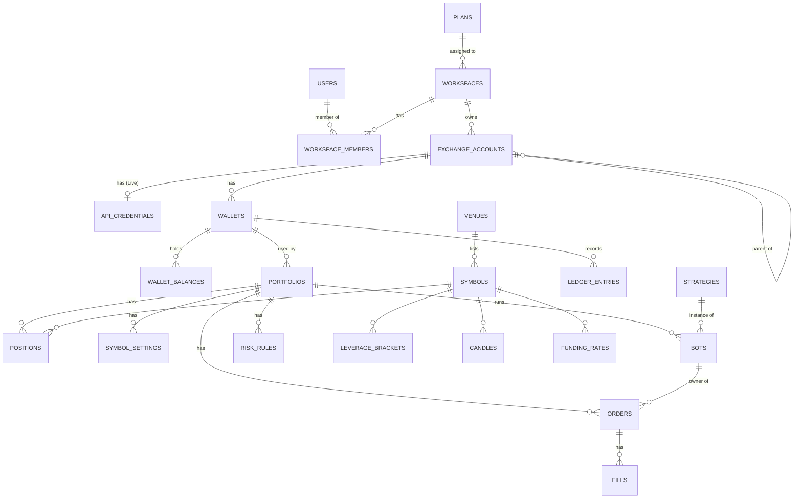

# TiewTrade — Data Model (PostgreSQL)

| Field | Value |
|---|---|
| Status | **v0.4** — M-01 ถึง M-05 Decided; ปรับตาม ADR-0009 ถึง 0013, Requirements Review และ API Review 2026-09-22 |
| Date | 2026-09-22 |
| Based on | [MVP Requirements](../requirements/mvp.md), [Architecture](../architecture/architecture.md), [Calculation Spec](calculation.md) |
| Scope | ตาราง, คอลัมน์หลัก, constraint, index, partitioning, tenant isolation (RLS), retention |
| Out of scope | Migration files (สร้างตอน implement ด้วย Alembic), API spec |

> **หลักการ**
> - DDL ในเอกสารนี้เป็น **ตัวอย่างเพื่อกำหนดโครงสร้าง** ไม่ใช่ migration จริง
> - ใช้ได้กับ **Cloud SQL for PostgreSQL 16+** (NFR-24): ไม่ใช้ TimescaleDB, ไม่ใช้ `uuidv7()` (PG18), ไม่พึ่ง advisory lock
> - ชื่อตาราง / คอลัมน์เป็น `snake_case` ตาม Glossary; ค่า enum ใช้ `TEXT + CHECK` แบบ `UPPER_SNAKE_CASE` เพราะชุดค่าจะเพิ่มขึ้นตามเวลา
> - Postgres เป็น source of truth ภายใน, Redis ไม่มีข้อมูลที่หายแล้วเสียความถูกต้อง (ADR-0003, ADR-0004)

---

## 1. Conventions

| เรื่อง | กติกา |
|---|---|
| ID ที่ออกไปนอกระบบ (Workspace, Portfolio, Bot, Order, ...) | `UUID DEFAULT gen_random_uuid()` — ไม่ให้เดาหรือไล่เลขข้าม Tenant ได้ |
| ID ภายในที่มีปริมาณมาก (ledger, fill, outbox, audit, candle) | `BIGINT GENERATED ALWAYS AS IDENTITY` |
| เงิน / ราคา / จำนวน | domain `dec` = `NUMERIC(38,18)` — ตรงกับ `Decimal` ใน core (FR-MRG-08) |
| อัตรา (fee, MMR, funding) | domain `rate` = `NUMERIC(20,12)` |
| เวลา | `TIMESTAMPTZ` เก็บ UTC (FR-I18N-06) |
| Enum | `TEXT NOT NULL CHECK (col IN (...))` |
| Tenant | ทุกตารางของผู้ใช้มี `workspace_id NOT NULL` (FR-TEN-01, §9) |
| FK | ทุก FK มี index ของคอลัมน์ที่อ้างถึง |
| Append-only | ledger, fills, audit_log: ห้าม UPDATE / DELETE ด้วยสิทธิ์ของ role และ trigger (ADR-0003, NFR-09) |

```sql
CREATE DOMAIN dec  AS NUMERIC(38,18);
CREATE DOMAIN rate AS NUMERIC(20,12);
```

---

## 2. ER Overview



---

## 3. Identity, Tenancy, Plans

### 3.1 users, sessions, admin_users
```sql
CREATE TABLE users (
  user_id          UUID PRIMARY KEY DEFAULT gen_random_uuid(),
  email            TEXT,                                   -- NULL หลังลบบัญชี (FR-LGL-06)
  password_hash    TEXT,                                   -- argon2 (ADR-0007)
  totp_secret_enc  BYTEA,                                  -- เข้ารหัสด้วย key ของ api
  totp_enabled     BOOLEAN NOT NULL DEFAULT false,
  locale           TEXT NOT NULL DEFAULT 'th' CHECK (locale IN ('th','en')),     -- FR-I18N-04
  timezone         TEXT NOT NULL DEFAULT 'Asia/Bangkok',                           -- FR-I18N-06
  liq_warning_ratio rate NOT NULL DEFAULT 0.8 CHECK (liq_warning_ratio > 0 AND liq_warning_ratio < 1),  -- FR-NTF-05
  status           TEXT NOT NULL DEFAULT 'ACTIVE' CHECK (status IN ('ACTIVE','SUSPENDED','DELETED')),
  created_at       TIMESTAMPTZ NOT NULL DEFAULT now(),
  deleted_at       TIMESTAMPTZ
);
CREATE UNIQUE INDEX users_email_uq ON users (LOWER(email)) WHERE email IS NOT NULL;

CREATE TABLE sessions (
  session_hash  BYTEA PRIMARY KEY,                -- เก็บเฉพาะ hash ของ session token
  principal_type TEXT NOT NULL CHECK (principal_type IN ('USER','ADMIN')),
  principal_id  UUID NOT NULL,
  created_at    TIMESTAMPTZ NOT NULL DEFAULT now(),
  expires_at    TIMESTAMPTZ NOT NULL,
  revoked_at    TIMESTAMPTZ,
  mfa_verified  BOOLEAN NOT NULL DEFAULT false,
  ip            INET,
  user_agent    TEXT
);
CREATE INDEX ON sessions (principal_type, principal_id);
CREATE INDEX ON sessions (expires_at);

-- MFA challenge ระหว่าง login: ไม่ใช่ session ใช้ได้กับ /auth/mfa/verify เท่านั้น (API §4.1)
CREATE TABLE mfa_challenges (
  challenge_hash BYTEA PRIMARY KEY,
  principal_type TEXT NOT NULL CHECK (principal_type IN ('USER','ADMIN')),
  principal_id   UUID NOT NULL,
  expires_at     TIMESTAMPTZ NOT NULL,          -- 5 นาที (API A-06)
  attempts       INT  NOT NULL DEFAULT 0 CHECK (attempts <= 5),
  consumed_at    TIMESTAMPTZ,
  created_at     TIMESTAMPTZ NOT NULL DEFAULT now()
);
CREATE INDEX ON mfa_challenges (expires_at);

-- Platform Admin แยกจาก users (FR-ADM-01)
CREATE TABLE admin_users (
  admin_id        UUID PRIMARY KEY DEFAULT gen_random_uuid(),
  email           TEXT NOT NULL,
  password_hash   TEXT NOT NULL,
  totp_secret_enc BYTEA NOT NULL,                 -- 2FA บังคับ
  status          TEXT NOT NULL DEFAULT 'ACTIVE' CHECK (status IN ('ACTIVE','DISABLED')),
  created_at      TIMESTAMPTZ NOT NULL DEFAULT now()
);
CREATE UNIQUE INDEX ON admin_users (LOWER(email));

CREATE TABLE user_consents (                      -- FR-LGL-05, FR-LIVE-08
  user_id       UUID NOT NULL REFERENCES users ON DELETE CASCADE,
  document_type TEXT NOT NULL CHECK (document_type IN ('TERMS','PRIVACY','RISK_DISCLOSURE')),
  version       TEXT NOT NULL,
  locale        TEXT NOT NULL CHECK (locale IN ('th','en')),
  accepted_at   TIMESTAMPTZ NOT NULL DEFAULT now(),
  PRIMARY KEY (user_id, document_type, version)
);
```

### 3.2 plans, workspaces
```sql
CREATE TABLE plans (
  plan_code  TEXT PRIMARY KEY CHECK (plan_code IN ('FREE','PRO','ADVANCED'))
);

-- Entitlement แบบ typed หนึ่งแถวต่อ Plan, Admin แก้ได้ (FR-PLN-02/03, FR-ADM-11)
CREATE TABLE plan_entitlements (
  plan_code             TEXT PRIMARY KEY REFERENCES plans,
  max_leverage          INT  NOT NULL CHECK (max_leverage BETWEEN 1 AND 125),
  paper_notional_limit  dec  NOT NULL CHECK (paper_notional_limit >= 0),
  live_enabled          BOOLEAN NOT NULL,
  live_notional_limit   dec  NOT NULL CHECK (live_notional_limit >= 0),
  max_paper_portfolios  INT  NOT NULL CHECK (max_paper_portfolios >= 0),
  max_live_portfolios   INT  NOT NULL CHECK (max_live_portfolios >= 0),
  updated_at            TIMESTAMPTZ NOT NULL DEFAULT now(),
  updated_by            UUID REFERENCES admin_users
);
-- ประวัติการแก้ค่าอยู่ใน audit_log (FR-PLN-12)

CREATE TABLE workspaces (
  workspace_id UUID PRIMARY KEY DEFAULT gen_random_uuid(),
  plan_code    TEXT NOT NULL REFERENCES plans,
  status       TEXT NOT NULL DEFAULT 'ACTIVE' CHECK (status IN ('ACTIVE','SUSPENDED','DELETED')),
  created_at   TIMESTAMPTZ NOT NULL DEFAULT now()
);
CREATE INDEX ON workspaces (plan_code);

CREATE TABLE workspace_members (
  workspace_id UUID NOT NULL REFERENCES workspaces ON DELETE CASCADE,
  user_id      UUID NOT NULL REFERENCES users ON DELETE CASCADE,
  role         TEXT NOT NULL DEFAULT 'OWNER' CHECK (role IN ('OWNER')),   -- Role อื่นเพิ่มภายหลัง (D-12)
  created_at   TIMESTAMPTZ NOT NULL DEFAULT now(),
  PRIMARY KEY (workspace_id, user_id)
);
CREATE INDEX ON workspace_members (user_id);
-- MVP: 1 คนต่อ Workspace และ 1 Workspace ต่อคน (FR-TEN-05) — ยกเลิกได้ภายหลังโดยไม่ย้ายข้อมูล
CREATE UNIQUE INDEX workspace_members_one_ws_per_user ON workspace_members (user_id);
CREATE UNIQUE INDEX workspace_members_one_user_per_ws ON workspace_members (workspace_id);
```

### 3.3 system_settings
ค่าระบบที่ Admin ปรับได้ (FR-ADM-04): slippage, fee rate ของ Paper ต่อ Venue / Market Type, เงินเริ่มต้นของ Paper, ความถี่ส่งราคา, Global Kill Switch
```sql
CREATE TABLE system_settings (
  setting_key  TEXT PRIMARY KEY CHECK (setting_key ~ '^[a-z0-9_.]+$'),
  value        JSONB NOT NULL,
  updated_at   TIMESTAMPTZ NOT NULL DEFAULT now(),
  updated_by   UUID REFERENCES admin_users
);
-- ตัวอย่าง key: paper.slippage_rate, paper.fee.binance_com.usdm_futures, paper.initial_balance_usdt,
--              strategy.price_throttle_ms, global.kill_switch
```
**Decided (M-01):** ใช้ key/value เพราะค่าชุดนี้เปลี่ยนตามเวลาและอ่านน้อย; schema ของแต่ละ key ตรวจใน application

---

## 4. Market Reference Data

```sql
CREATE TABLE venues (
  venue_code TEXT PRIMARY KEY CHECK (venue_code IN ('BINANCE_COM','BINANCE_TH'))    -- FR-LGL-02
);

CREATE TABLE symbols (
  symbol_id        BIGINT GENERATED ALWAYS AS IDENTITY PRIMARY KEY,
  venue_code       TEXT NOT NULL REFERENCES venues,
  market_type      TEXT NOT NULL CHECK (market_type IN ('SPOT','USDM_FUTURES')),
  symbol           TEXT NOT NULL,                  -- เช่น BTCUSDT
  base_asset       TEXT NOT NULL,
  quote_asset      TEXT NOT NULL CHECK (quote_asset = 'USDT'),                        -- D-15
  tick_size        dec  NOT NULL CHECK (tick_size > 0),
  step_size        dec  NOT NULL CHECK (step_size > 0),
  min_qty          dec  NOT NULL,
  max_qty          dec,
  min_notional     dec  NOT NULL,
  whitelist_status TEXT NOT NULL DEFAULT 'DISABLED'
                   CHECK (whitelist_status IN ('TRADING','CLOSE_ONLY','DISABLED')),  -- FR-MKT-13..16
  liquidation_clearance_rate rate,                 -- Futures เท่านั้น (Calculation §4.4, C-05)
  filters_updated_at TIMESTAMPTZ NOT NULL,
  UNIQUE (venue_code, market_type, symbol)
);
CREATE INDEX ON symbols (whitelist_status) WHERE whitelist_status <> 'DISABLED';

-- Leverage Bracket แบบมีเวอร์ชัน (Calculation §2.3)
CREATE TABLE leverage_brackets (
  symbol_id      BIGINT NOT NULL REFERENCES symbols,
  effective_from TIMESTAMPTZ NOT NULL,
  bracket        INT  NOT NULL CHECK (bracket >= 1),
  notional_floor dec  NOT NULL,
  notional_cap   dec  NOT NULL CHECK (notional_cap > notional_floor),
  mmr            rate NOT NULL,
  cum            dec  NOT NULL,
  max_leverage   INT  NOT NULL CHECK (max_leverage >= 1),
  PRIMARY KEY (symbol_id, effective_from, bracket)
);

-- Funding: job ส่วนกลาง 1 แถวต่อ (Venue, Symbol, funding time) — Venue อยู่ใน symbol_id (Calculation §2.9)
CREATE TABLE funding_rates (
  symbol_id    BIGINT NOT NULL REFERENCES symbols,
  funding_time TIMESTAMPTZ NOT NULL,
  funding_rate rate NOT NULL,
  mark_price   dec  NOT NULL,
  PRIMARY KEY (symbol_id, funding_time)
);
```

### 4.1 Candles (NFR-18, NFR-24)
แยก 2 ตารางตามระยะเวลาเก็บ เพื่อลบข้อมูลเก่าด้วยการ drop partition ได้ (**Decided M-02**)
```sql
-- 1m, 5m, 15m, 30m — เก็บ 2 ปี, partition รายเดือน
CREATE TABLE candles_intraday (
  symbol_id   BIGINT NOT NULL,
  timeframe   TEXT   NOT NULL CHECK (timeframe IN ('1m','5m','15m','30m')),
  open_time   TIMESTAMPTZ NOT NULL,
  open        dec NOT NULL, high dec NOT NULL, low dec NOT NULL, close dec NOT NULL,
  volume      dec NOT NULL,
  quote_volume dec NOT NULL,
  trade_count BIGINT NOT NULL,
  PRIMARY KEY (symbol_id, timeframe, open_time)
) PARTITION BY RANGE (open_time);
-- เช่น CREATE TABLE candles_intraday_2026_09 PARTITION OF candles_intraday
--      FOR VALUES FROM ('2026-09-01') TO ('2026-10-01');
-- job สร้าง partition ล่วงหน้า และ DROP partition ที่เก่ากว่า 2 ปี

-- 1h, 4h, 1d — เก็บตลอดไป (ขนาดเล็ก ไม่ต้อง partition)
CREATE TABLE candles_daily_hourly (
  symbol_id   BIGINT NOT NULL REFERENCES symbols,
  timeframe   TEXT   NOT NULL CHECK (timeframe IN ('1h','4h','1d')),
  open_time   TIMESTAMPTZ NOT NULL,
  open        dec NOT NULL, high dec NOT NULL, low dec NOT NULL, close dec NOT NULL,
  volume      dec NOT NULL,
  quote_volume dec NOT NULL,
  trade_count BIGINT NOT NULL,
  PRIMARY KEY (symbol_id, timeframe, open_time)
);
```
- `candles_intraday` ไม่มี FK ไป `symbols` เพื่อให้ insert จำนวนมากเร็ว; ตรวจความถูกต้องที่ market-data
- ขนาดโดยประมาณ: 50 Symbol × 2 ตลาด × (525,600 + 105,120 + 35,040 + 17,520) แถว/ปี ≈ 68 ล้านแถว/ปี → ≈ 137 ล้านแถวที่ 2 ปี

---

## 5. Accounts, Wallets, Credentials

### 5.1 exchange_accounts
```sql
CREATE TABLE exchange_accounts (
  exchange_account_id UUID PRIMARY KEY DEFAULT gen_random_uuid(),
  workspace_id        UUID NOT NULL REFERENCES workspaces,
  trading_mode        TEXT NOT NULL CHECK (trading_mode IN ('PAPER','LIVE')),        -- FR-ACC-04
  venue_code          TEXT NOT NULL REFERENCES venues,     -- Paper ใช้ market data ของ Venue นี้
  account_role        TEXT NOT NULL CHECK (account_role IN ('MAIN','SUB')),
  parent_account_id   UUID REFERENCES exchange_accounts,  -- SUB → MAIN (Paper); Live อาจว่าง (D-04)
  label               TEXT NOT NULL CHECK (LENGTH(label) <= 100),
  binance_account_uid TEXT,                                -- Live เท่านั้น (FR-SEC-11)
  position_mode       TEXT CHECK (position_mode IN ('ONE_WAY','HEDGE')),       -- ค่าที่อ่านจาก Binance ล่าสุด (D-03)
  multi_assets_mode   BOOLEAN,
  intended_market_type TEXT CHECK (intended_market_type IN ('SPOT','USDM_FUTURES')),  -- Live: ตลาดที่ตรวจสิทธิ์ตอนเชื่อม (API §4.4)
  status              TEXT NOT NULL DEFAULT 'ACTIVE' CHECK (status IN ('PENDING_MODE_CHANGE','ACTIVE','DISABLED','ARCHIVED')),
  created_at          TIMESTAMPTZ NOT NULL DEFAULT now(),
  CHECK (trading_mode = 'LIVE' OR binance_account_uid IS NULL),
  CHECK (trading_mode = 'PAPER' OR intended_market_type IS NOT NULL),
  CHECK (account_role = 'MAIN' OR trading_mode = 'LIVE' OR parent_account_id IS NOT NULL)
);
CREATE INDEX ON exchange_accounts (workspace_id);
CREATE INDEX ON exchange_accounts (parent_account_id);
-- หนึ่งบัญชี Binance เชื่อมได้ที่เดียวในระบบ (FR-SEC-11)
CREATE UNIQUE INDEX exchange_accounts_binance_uid_uq
  ON exchange_accounts (venue_code, binance_account_uid)
  WHERE binance_account_uid IS NOT NULL AND status <> 'ARCHIVED';
-- Paper Main Account หนึ่งบัญชีต่อ Workspace
CREATE UNIQUE INDEX exchange_accounts_one_paper_main
  ON exchange_accounts (workspace_id) WHERE trading_mode = 'PAPER' AND account_role = 'MAIN';
```

### 5.2 api_credentials (Live, ADR-0005)
```sql
CREATE TABLE api_credentials (
  exchange_account_id UUID PRIMARY KEY REFERENCES exchange_accounts ON DELETE CASCADE,
  workspace_id        UUID NOT NULL REFERENCES workspaces,
  api_key             TEXT NOT NULL,            -- ส่วน public ของ Key; แสดงแบบ masked (FR-SEC-03)
  secret_ciphertext   BYTEA NOT NULL,           -- RSA-OAEP-4096-SHA256 จาก browser; api ถอดไม่ได้ (FR-SEC-02, ADR-0012)
  format_version      INT  NOT NULL DEFAULT 1 CHECK (format_version IN (1)),   -- 1 = RSA-OAEP-4096-SHA256
  encryption_key_id   TEXT NOT NULL,            -- key และเวอร์ชัน (VM PEM / Cloud KMS key version); rewrap job อัปเดต
  permissions         JSONB NOT NULL,           -- snapshot ตอนตรวจ (FR-SEC-04/10/12)
  ip_restricted       BOOLEAN NOT NULL CHECK (ip_restricted),          -- บังคับ (FR-SEC-05)
  validated_at        TIMESTAMPTZ NOT NULL,
  created_at          TIMESTAMPTZ NOT NULL DEFAULT now()
);
CREATE INDEX ON api_credentials (workspace_id);
```
- ลบ Credential = **DELETE แถวทันที** (hard delete) และบันทึก audit_log (FR-SEC-09, FR-LGL-06)
- ห้ามมีคอลัมน์ Secret แบบ plaintext หรือ hash ของ Secret

### 5.3 wallets, wallet_balances
Wallet ตาม Market Type ของบัญชี (Glossary) Portfolio ใช้ Wallet เดียว (D-01)
```sql
CREATE TABLE wallets (
  wallet_id           UUID PRIMARY KEY DEFAULT gen_random_uuid(),
  workspace_id        UUID NOT NULL REFERENCES workspaces,
  exchange_account_id UUID NOT NULL REFERENCES exchange_accounts,
  wallet_type         TEXT NOT NULL CHECK (wallet_type IN ('SPOT','USDM_FUTURES')),
  UNIQUE (exchange_account_id, wallet_type)
);
CREATE INDEX ON wallets (workspace_id);

CREATE TABLE wallet_balances (
  wallet_id      UUID NOT NULL REFERENCES wallets,
  workspace_id   UUID NOT NULL,
  asset          TEXT NOT NULL,                 -- MVP: USDT (D-15)
  wallet_balance dec  NOT NULL,                 -- Futures: cross WB; Spot: free + locked
  locked         dec  NOT NULL DEFAULT 0 CHECK (locked >= 0),   -- Spot: จองใน Order ค้าง (Calculation §3.3)
  updated_at     TIMESTAMPTZ NOT NULL DEFAULT now(),
  last_ledger_entry_id BIGINT,                  -- ใช้ตรวจความตรงกันกับ ledger (ADR-0003)
  PRIMARY KEY (wallet_id, asset)
);
```
- Paper Main Account มี Wallet `SPOT` ที่เริ่มด้วย 10,000 USDT (FR-ACC-07)
- Live: ค่าใน wallet_balances เป็นสำเนาจาก Binance (P-08)

---

## 6. Portfolio & Trading State

### 6.1 portfolios
```sql
CREATE TABLE portfolios (
  portfolio_id  UUID PRIMARY KEY DEFAULT gen_random_uuid(),
  workspace_id  UUID NOT NULL REFERENCES workspaces,
  wallet_id     UUID NOT NULL REFERENCES wallets,
  market_type   TEXT NOT NULL CHECK (market_type IN ('SPOT','USDM_FUTURES')),     -- FR-PF-00b
  trading_mode  TEXT NOT NULL CHECK (trading_mode IN ('PAPER','LIVE')),           -- สืบทอดจากบัญชี (FR-ACC-04)
  name          TEXT NOT NULL CHECK (LENGTH(name) <= 100),
  status        TEXT NOT NULL DEFAULT 'ACTIVE' CHECK (status IN ('ACTIVE','ARCHIVED')),  -- ARCHIVED หลัง Reset (FR-ACC-09)
  trading_restriction TEXT CHECK (trading_restriction IN ('UNSUPPORTED_ACCOUNT_MODE')),     -- FR-LIVE-19; NULL = ปกติ
  restricted_at TIMESTAMPTZ,
  archived_at   TIMESTAMPTZ,
  created_at    TIMESTAMPTZ NOT NULL DEFAULT now(),
  CHECK ((status = 'ARCHIVED') = (archived_at IS NOT NULL))
);
CREATE INDEX ON portfolios (workspace_id, status);
-- 1 Wallet (= 1 บัญชี × 1 Market Type) มี Portfolio ACTIVE ได้ 1 ตัว (D-01, FR-PF-00a/e)
CREATE UNIQUE INDEX portfolios_one_active_per_wallet ON portfolios (wallet_id) WHERE status = 'ACTIVE';
```
- ความสอดคล้อง `market_type = wallets.wallet_type` และ `trading_mode = exchange_accounts.trading_mode` ตรวจใน application ตอนสร้าง (ค่าไม่เปลี่ยนภายหลัง)
- จำนวน Portfolio ต่อ Plan (FR-PLN-03) ตรวจใน application และนับเฉพาะ `status = 'ACTIVE'` (FR-ACC-12)
- `trading_restriction IS NOT NULL` → Risk Engine ปฏิเสธ Order ทุกชนิด ยกเว้นการยกเลิก (FR-LIVE-19)

### 6.2 symbol_settings, positions
```sql
CREATE TABLE symbol_settings (                  -- Leverage / Margin Mode ต่อ Symbol (Futures)
  portfolio_id UUID   NOT NULL REFERENCES portfolios,
  symbol_id    BIGINT NOT NULL REFERENCES symbols,
  workspace_id UUID   NOT NULL,
  leverage     INT    NOT NULL CHECK (leverage >= 1),
  margin_mode  TEXT   NOT NULL CHECK (margin_mode IN ('CROSS','ISOLATED')),
  updated_at   TIMESTAMPTZ NOT NULL DEFAULT now(),
  PRIMARY KEY (portfolio_id, symbol_id)
);

CREATE TABLE positions (
  portfolio_id    UUID   NOT NULL REFERENCES portfolios,
  symbol_id       BIGINT NOT NULL REFERENCES symbols,
  position_side   TEXT   NOT NULL DEFAULT 'BOTH' CHECK (position_side IN ('BOTH','LONG','SHORT')),  -- MVP: BOTH (FR-MKT-09)
  workspace_id    UUID   NOT NULL,
  quantity        dec    NOT NULL,             -- มีเครื่องหมาย (Futures); Spot = Base Asset ที่ถือ ≥ 0
  entry_price     dec,                         -- Futures: EP; Spot: Average Cost แบบไม่รวม Fee (C-07)
  isolated_wallet dec,                         -- Futures isolated เท่านั้น
  episode_id      UUID,                        -- Position Episode ปัจจุบัน; NULL เมื่อ quantity = 0 (FR-PF-11)
  updated_at      TIMESTAMPTZ NOT NULL DEFAULT now(),
  PRIMARY KEY (portfolio_id, symbol_id, position_side),
  CHECK ((quantity = 0) = (entry_price IS NULL))
);
CREATE INDEX ON positions (symbol_id) WHERE quantity <> 0;   -- engine หา Portfolio ที่ถือ Symbol
```
- Position ที่ปิดแล้วเก็บแถวไว้ด้วย `quantity = 0` (ไม่ลบ) เพื่อลด churn; ประวัติอยู่ใน fills และ ledger

### 6.3 bots, strategies
```sql
CREATE TABLE strategies (                        -- Built-in Strategy (D-06)
  strategy_code    TEXT NOT NULL,
  version          TEXT NOT NULL,
  parameter_schema JSONB NOT NULL,               -- FR-STR-11
  enabled          BOOLEAN NOT NULL DEFAULT false,   -- Admin เปิด / ปิด (FR-ADM-02)
  created_at       TIMESTAMPTZ NOT NULL DEFAULT now(),
  PRIMARY KEY (strategy_code, version)
);

CREATE TABLE bots (
  bot_id           UUID PRIMARY KEY DEFAULT gen_random_uuid(),
  workspace_id     UUID NOT NULL REFERENCES workspaces,
  portfolio_id     UUID NOT NULL REFERENCES portfolios,
  strategy_code    TEXT NOT NULL,
  strategy_version TEXT NOT NULL,
  parameters       JSONB NOT NULL,               -- ผ่านการตรวจกับ parameter_schema แล้ว
  status           TEXT NOT NULL CHECK (status IN ('RUNNING','PAUSED','STOPPED','ERROR')),
  pause_reason     TEXT CHECK (pause_reason IN ('MANUAL_INTERVENTION','EXTERNAL_CHANGE','ACCOUNT_MODE_CHANGED',
                                                'ENTITLEMENT_EXCEEDED','RECONCILIATION_MISMATCH','GLOBAL_KILL_SWITCH',
                                                'KILL_SWITCH','RISK_LIMIT','PROTECTION_FAILED','TRADING_RESTRICTION','USER')),
  created_at       TIMESTAMPTZ NOT NULL DEFAULT now(),
  started_at       TIMESTAMPTZ,
  stopped_at       TIMESTAMPTZ,
  FOREIGN KEY (strategy_code, strategy_version) REFERENCES strategies,
  CHECK ((status = 'PAUSED') = (pause_reason IS NOT NULL))
);
CREATE INDEX ON bots (workspace_id);
CREATE INDEX ON bots (strategy_code, strategy_version);
-- Active Bot ได้ 1 ตัวต่อ Portfolio (D-02, FR-STR-09)
CREATE UNIQUE INDEX bots_one_active_per_portfolio ON bots (portfolio_id) WHERE status <> 'STOPPED';

CREATE TABLE bot_symbols (
  bot_id    UUID   NOT NULL REFERENCES bots ON DELETE CASCADE,
  symbol_id BIGINT NOT NULL REFERENCES symbols,
  PRIMARY KEY (bot_id, symbol_id)
);
CREATE INDEX ON bot_symbols (symbol_id);
```

### 6.4 risk_rules
```sql
CREATE TABLE risk_rules (                        -- FR-RSK-01/02
  portfolio_id UUID NOT NULL REFERENCES portfolios,
  workspace_id UUID NOT NULL,
  rule_code    TEXT NOT NULL,                    -- เช่น MAX_LEVERAGE, MAX_DAILY_LOSS, REQUIRE_STOP_LOSS
  params       JSONB NOT NULL,
  enabled      BOOLEAN NOT NULL DEFAULT true,
  updated_at   TIMESTAMPTZ NOT NULL DEFAULT now(),
  PRIMARY KEY (portfolio_id, rule_code)
);
```

### 6.5 orders, fills
```sql
CREATE TABLE orders (
  order_id          UUID PRIMARY KEY DEFAULT gen_random_uuid(),
  workspace_id      UUID NOT NULL,
  portfolio_id      UUID NOT NULL REFERENCES portfolios,
  symbol_id         BIGINT NOT NULL REFERENCES symbols,
  client_order_id   TEXT NOT NULL,               -- สร้างและบันทึกก่อนส่ง (Architecture §4.4)
  exchange_order_id TEXT,
  owner_type        TEXT NOT NULL CHECK (owner_type IN ('BOT','MANUAL','EXTERNAL')),   -- D-02, D-14
  bot_id            UUID REFERENCES bots,
  bracket_id        UUID,
  bracket_role      TEXT CHECK (bracket_role IN ('ENTRY','TAKE_PROFIT','STOP_LOSS')),
  side              TEXT NOT NULL CHECK (side IN ('BUY','SELL')),
  order_type        TEXT NOT NULL CHECK (order_type IN ('MARKET','LIMIT','STOP_MARKET','TAKE_PROFIT_MARKET')),
  time_in_force     TEXT CHECK (time_in_force IN ('GTC','IOC','FOK')),
  quantity          dec NOT NULL CHECK (quantity > 0),
  price             dec,
  stop_price        dec,
  reduce_only       BOOLEAN NOT NULL DEFAULT false,
  status            TEXT NOT NULL CHECK (status IN ('PENDING_NEW','NEW','PARTIALLY_FILLED','FILLED',
                                                   'CANCELED','REJECTED','EXPIRED')),
  filled_quantity   dec NOT NULL DEFAULT 0,
  avg_fill_price    dec,
  reject_reason     TEXT,                        -- รวมผลจาก Risk Engine (FR-ORD-05)
  created_at        TIMESTAMPTZ NOT NULL DEFAULT now(),
  updated_at        TIMESTAMPTZ NOT NULL DEFAULT now(),
  CHECK ((owner_type = 'BOT') = (bot_id IS NOT NULL)),
  CHECK (filled_quantity >= 0 AND filled_quantity <= quantity),
  CHECK (owner_type <> 'EXTERNAL' OR exchange_order_id IS NOT NULL)
);
-- Client Order ID ของระบบไม่ซ้ำ (idempotency); Order นอกระบบใช้ ID ของ Binance แทน เพราะ Binance
-- บังคับ client id ไม่ซ้ำเฉพาะ Order ที่ยังเปิดอยู่ จึงอาจถูกใช้ซ้ำภายหลัง
CREATE UNIQUE INDEX orders_client_order_id_uq ON orders (portfolio_id, client_order_id) WHERE owner_type <> 'EXTERNAL';
CREATE UNIQUE INDEX orders_exchange_order_id_uq ON orders (portfolio_id, exchange_order_id) WHERE exchange_order_id IS NOT NULL;
CREATE INDEX ON orders (workspace_id, created_at DESC);
CREATE INDEX ON orders (bot_id) WHERE bot_id IS NOT NULL;
CREATE INDEX ON orders (bracket_id) WHERE bracket_id IS NOT NULL;
CREATE INDEX orders_open ON orders (portfolio_id, symbol_id)
  WHERE status IN ('PENDING_NEW','NEW','PARTIALLY_FILLED');
```
- `PENDING_NEW` = บันทึกแล้วแต่ยังไม่ได้รับการยืนยันจาก Venue; เมื่อ timeout ต้อง query ด้วย `client_order_id` ก่อน retry (FR-LIVE-07)
- ข้อความที่ Risk Engine ปฏิเสธก่อนสร้าง Order จริงบันทึกใน audit_log (FR-ORD-05) ไม่สร้างแถวใน orders

```sql
CREATE TABLE fills (                             -- append-only
  fill_id           BIGINT GENERATED ALWAYS AS IDENTITY PRIMARY KEY,
  workspace_id      UUID NOT NULL,
  portfolio_id      UUID NOT NULL REFERENCES portfolios,
  order_id          UUID NOT NULL REFERENCES orders,
  symbol_id         BIGINT NOT NULL REFERENCES symbols,
  exchange_trade_id TEXT NOT NULL,               -- Paper: ID ที่ Paper Adapter สร้าง
  side              TEXT NOT NULL CHECK (side IN ('BUY','SELL')),
  quantity          dec NOT NULL CHECK (quantity > 0),
  price             dec NOT NULL CHECK (price > 0),
  liquidity         TEXT NOT NULL CHECK (liquidity IN ('MAKER','TAKER')),
  fee               dec NOT NULL,
  fee_asset         TEXT NOT NULL,
  realized_pnl      dec NOT NULL DEFAULT 0,      -- gross ไม่รวม Fee (Glossary, Calculation §2.6/§3.1)
  episode_id        UUID NOT NULL,               -- ผลเป็นของ Episode (FR-PF-11); Fill ที่กลับทิศแยกเป็น 2 แถว (ปิด / เปิด)
  is_liquidation    BOOLEAN NOT NULL DEFAULT false,
  filled_at         TIMESTAMPTZ NOT NULL,
  UNIQUE (order_id, exchange_trade_id)           -- idempotency (Architecture §6.3)
);
CREATE INDEX ON fills (portfolio_id, filled_at);  -- Trade Marker บน Chart (FR-CHT-08), Analytics
```

### 6.6 ledger_entries (ADR-0003)
```sql
CREATE TABLE ledger_entries (                    -- append-only
  entry_id        BIGINT GENERATED ALWAYS AS IDENTITY PRIMARY KEY,
  workspace_id    UUID NOT NULL,
  wallet_id       UUID NOT NULL REFERENCES wallets,
  portfolio_id    UUID REFERENCES portfolios,    -- NULL สำหรับ Paper Main Account (กองกลาง)
  entry_type      TEXT NOT NULL CHECK (entry_type IN (
                    'REALIZED_PNL','TRADING_FEE','FUNDING_FEE',
                    'TRANSFER_IN','TRANSFER_OUT','VIRTUAL_DEPOSIT',
                    'LIQUIDATION_CLEARANCE_FEE','LIQUIDATION_FORFEIT','INSURANCE_ABSORBED',
                    'ISOLATED_MARGIN_MOVE','EXTERNAL_DEPOSIT','EXTERNAL_WITHDRAWAL',
                    'RECONCILIATION_ADJUSTMENT')),
  asset           TEXT NOT NULL,
  amount          dec  NOT NULL,                 -- + เข้า, − ออก
  balance_after   dec  NOT NULL,
  is_capital_flow BOOLEAN NOT NULL,              -- เงินเข้า/ออก ไม่นับเป็นกำไร (FR-ACC-11, D-14)
  symbol_id       BIGINT REFERENCES symbols,
  fill_id         BIGINT REFERENCES fills,
  episode_id      UUID,                          -- Fee / Funding / Liquidation ของ Position (FR-PF-11)
  idempotency_key TEXT NOT NULL UNIQUE,          -- เช่น funding:{portfolio}:{symbol_id}:{funding_time}
  occurred_at     TIMESTAMPTZ NOT NULL,
  created_at      TIMESTAMPTZ NOT NULL DEFAULT now()
);
CREATE INDEX ON ledger_entries (wallet_id, entry_id);
CREATE INDEX ON ledger_entries (portfolio_id, occurred_at);
CREATE INDEX ON ledger_entries (fill_id) WHERE fill_id IS NOT NULL;
CREATE INDEX ON ledger_entries (symbol_id) WHERE symbol_id IS NOT NULL;
```
- `idempotency_key` รวม Portfolio เสมอสำหรับ Funding (แก้ประเด็นใน Calculation §2.9)
- **Invariant (property test):** `wallet_balances.wallet_balance` = ผลรวม `amount` ของ ledger ของ Wallet และ asset นั้น
- `is_capital_flow = true` สำหรับ `TRANSFER_*`, `VIRTUAL_DEPOSIT`, `EXTERNAL_*`
- **Reset Portfolio (FR-ACC-09):** `TRANSFER_OUT` ยอดคงเหลือทั้งหมดจาก Wallet ของ Sub-account → `TRANSFER_IN` ที่ Wallet ของ Paper Main (อ้าง Portfolio เดิม) ใน transaction เดียว แล้วจึง Archive Portfolio เดิมและสร้าง Portfolio ใหม่ที่ยอด 0

### 6.6a position_episodes (FR-PF-11, FR-ANL-03)
```sql
CREATE TABLE position_episodes (
  episode_id     UUID PRIMARY KEY DEFAULT gen_random_uuid(),
  workspace_id   UUID NOT NULL,
  portfolio_id   UUID NOT NULL REFERENCES portfolios,
  symbol_id      BIGINT NOT NULL REFERENCES symbols,
  side           TEXT NOT NULL CHECK (side IN ('LONG','SHORT')),
  opened_by_type TEXT NOT NULL CHECK (opened_by_type IN ('BOT','MANUAL','EXTERNAL')),  -- เจ้าของผลของ Episode
  opened_by_bot_id UUID REFERENCES bots,
  opened_at      TIMESTAMPTZ NOT NULL,
  closed_at      TIMESTAMPTZ,
  realized_pnl   dec NOT NULL DEFAULT 0,        -- สรุปจาก fills (gross)
  fees           dec NOT NULL DEFAULT 0,
  funding        dec NOT NULL DEFAULT 0,
  CHECK ((opened_by_type = 'BOT') = (opened_by_bot_id IS NOT NULL))
);
CREATE INDEX ON position_episodes (portfolio_id, opened_at);
CREATE INDEX ON position_episodes (opened_by_bot_id) WHERE opened_by_bot_id IS NOT NULL;
-- Episode เปิดได้ครั้งละ 1 ต่อ (Portfolio, Symbol) ใน One-way
CREATE UNIQUE INDEX position_episodes_one_open ON position_episodes (portfolio_id, symbol_id) WHERE closed_at IS NULL;
```
- Analytics ระดับ Bot = Episode ที่ `opened_by_bot_id` เป็น Bot นั้น; Win Rate นับต่อ Episode
- ยอดสรุปใน Episode ต้องเท่ากับผลรวมของ fills / ledger ที่อ้าง Episode เดียวกัน (property test)

### 6.7 performance_snapshots (FR-ANL)
```sql
CREATE TABLE performance_snapshots (
  portfolio_id     UUID NOT NULL REFERENCES portfolios,
  snapshot_time    TIMESTAMPTZ NOT NULL,
  workspace_id     UUID NOT NULL,
  equity           dec NOT NULL,
  realized_pnl_cum dec NOT NULL,
  fees_cum         dec NOT NULL,
  funding_cum      dec NOT NULL,
  net_capital_flow_cum dec NOT NULL,
  PRIMARY KEY (portfolio_id, snapshot_time)
);
```
- ความถี่ (**Decided M-03**): รายชั่วโมง + ทุกครั้งที่ปิด Position; Equity Curve และ Metric คำนวณจากตารางนี้และ ledger

---

## 7. Engine Infrastructure

```sql
-- Lease + fencing token (ADR-0002, ADR-0009, ADR-0010, NFR-21)
CREATE TABLE leases (
  resource_type TEXT NOT NULL CHECK (resource_type IN ('WORKSPACE','MARKET_DATA_VENUE','EXECUTION_ACCOUNT')),
  resource_id   TEXT NOT NULL,
  owner_id      TEXT NOT NULL,                  -- instance id ของ process
  fencing_token BIGINT NOT NULL,                -- เพิ่มขึ้นทุกครั้งที่เปลี่ยนเจ้าของ
  expires_at    TIMESTAMPTZ NOT NULL,
  PRIMARY KEY (resource_type, resource_id)
);
CREATE INDEX ON leases (expires_at);

CREATE TABLE workspace_checkpoints (             -- recovery / replay (NFR-14, NFR-15, ADR-0009)
  workspace_id        UUID PRIMARY KEY REFERENCES workspaces,
  fencing_token       BIGINT NOT NULL,          -- ทุกการเขียน state ของทุก Portfolio ใน Workspace ตรวจกับค่านี้
  last_processed_at   TIMESTAMPTZ NOT NULL
);

CREATE TABLE portfolio_checkpoints (             -- เวลาที่ประมวลผลล่าสุดต่อ Portfolio สำหรับ replay
  portfolio_id        UUID PRIMARY KEY REFERENCES portfolios,
  workspace_id        UUID NOT NULL,
  state_version       BIGINT NOT NULL DEFAULT 0,   -- +1 ทุก transaction ที่เปลี่ยน state; = seq ของ WebSocket (API §5.2)
  last_processed_at   TIMESTAMPTZ NOT NULL,
  last_reconciled_at  TIMESTAMPTZ
);

-- Command แบบทนทาน: บันทึกก่อน publish (ADR-0011)
CREATE TABLE commands (
  command_id    UUID PRIMARY KEY DEFAULT gen_random_uuid(),   -- สร้างโดยระบบ (API §3)
  workspace_id  UUID NOT NULL,
  principal_type TEXT NOT NULL CHECK (principal_type IN ('USER','ADMIN','JOB')),
  principal_id  TEXT NOT NULL,
  idempotency_key TEXT,                          -- จาก header Idempotency-Key (job อาจไม่มี)
  request_fingerprint BYTEA,                     -- hash(principal, workspace, method, route, path params, normalized body)
  portfolio_id  UUID,
  command_type  TEXT NOT NULL,                  -- เช่น PLACE_ORDER, START_BOT, KILL_SWITCH, RESET_PORTFOLIO
  payload       JSONB NOT NULL,
  issued_by     TEXT NOT NULL,                  -- user / admin / job
  status        TEXT NOT NULL DEFAULT 'PENDING' CHECK (status IN ('PENDING','PROCESSED')),
  result        JSONB,
  created_at    TIMESTAMPTZ NOT NULL DEFAULT now(),
  processed_at  TIMESTAMPTZ,
  CHECK ((status = 'PROCESSED') = (processed_at IS NOT NULL))
);
CREATE INDEX commands_pending ON commands (workspace_id, created_at) WHERE status = 'PENDING';
CREATE UNIQUE INDEX commands_idempotency_uq ON commands (workspace_id, principal_type, principal_id, idempotency_key)
  WHERE idempotency_key IS NOT NULL;
CREATE INDEX ON commands (processed_at) WHERE processed_at IS NOT NULL;

-- Transactional outbox: published_at = ส่งเข้า Redis แล้วเท่านั้น (ADR-0003, ADR-0011)
CREATE TABLE outbox (
  outbox_id    BIGINT GENERATED ALWAYS AS IDENTITY PRIMARY KEY,
  stream       TEXT NOT NULL,                    -- เช่น cmd.exec.{account}, evt.workspace.{id}
  event_type   TEXT NOT NULL,
  payload      JSONB NOT NULL,                   -- command ไป execution มี workspace fencing token + valid_until
  required_consumers TEXT[] NOT NULL DEFAULT '{}',  -- ผู้รับที่ต้องประมวลผลก่อนลบได้
  created_at   TIMESTAMPTZ NOT NULL DEFAULT now(),
  published_at TIMESTAMPTZ
);
CREATE INDEX outbox_unpublished ON outbox (outbox_id) WHERE published_at IS NULL;

-- Inbox: ผู้รับบันทึกการประมวลผลใน transaction เดียวกับผล (ADR-0011)
CREATE TABLE inbox (
  consumer     TEXT NOT NULL,                    -- เช่น execution, notifier
  message_id   BIGINT NOT NULL,                  -- outbox_id
  processed_at TIMESTAMPTZ NOT NULL DEFAULT now(),
  PRIMARY KEY (consumer, message_id)
);
CREATE INDEX ON inbox (processed_at);

-- Dispatch ไป Binance: บันทึกก่อนส่ง (ADR-0010)
CREATE TABLE execution_dispatches (
  dispatch_id         BIGINT GENERATED ALWAYS AS IDENTITY PRIMARY KEY,
  exchange_account_id UUID NOT NULL REFERENCES exchange_accounts,
  workspace_id        UUID NOT NULL,
  order_id            UUID NOT NULL REFERENCES orders,
  outbox_id           BIGINT NOT NULL,          -- command ที่สั่ง
  action              TEXT NOT NULL CHECK (action IN ('NEW','CANCEL')),
  lease_token         BIGINT NOT NULL,          -- token ของ lease บัญชี ณ ตอน dispatch
  request_timestamp   TIMESTAMPTZ NOT NULL,     -- ใช้เป็น timestamp ใน request ที่ลงนาม
  status              TEXT NOT NULL CHECK (status IN ('DISPATCHING','ACKED','REJECTED','UNKNOWN_RESOLVED','ABORTED')),
  response            JSONB,
  created_at          TIMESTAMPTZ NOT NULL DEFAULT now(),
  updated_at          TIMESTAMPTZ NOT NULL DEFAULT now(),
  UNIQUE (outbox_id, action)
);
CREATE INDEX ON execution_dispatches (order_id);
CREATE INDEX execution_dispatches_inflight ON execution_dispatches (exchange_account_id) WHERE status = 'DISPATCHING';
```
**การเขียน state แบบมี fencing:** ทุก transaction ของ engine ตรวจ `workspace_checkpoints.fencing_token` ด้วย `UPDATE ... WHERE workspace_id = :id AND fencing_token = :token` ถ้าไม่มีแถวถูกอัปเดตให้ rollback (เสีย lease แล้ว); execution ทำแบบเดียวกันกับ `leases` ของ `EXECUTION_ACCOUNT` ก่อนสร้าง dispatch

**Session (ADR-0013):** ตาราง `sessions` เป็นแหล่งเดียวที่ตัดสิน ไม่มี cache ใน MVP

---

## 8. Notifications, Audit

```sql
CREATE TABLE notifications (                     -- In-app (FR-NTF-01)
  notification_id BIGINT GENERATED ALWAYS AS IDENTITY PRIMARY KEY,
  workspace_id    UUID NOT NULL,
  user_id         UUID NOT NULL REFERENCES users ON DELETE CASCADE,
  event_type      TEXT NOT NULL,
  severity        TEXT NOT NULL CHECK (severity IN ('INFO','WARNING','CRITICAL')),
  payload         JSONB NOT NULL,                -- ข้อความแปลตาม locale ตอนแสดง (FR-I18N-02)
  dedupe_key      TEXT NOT NULL UNIQUE,          -- กันส่งซ้ำ (NFR-22)
  created_at      TIMESTAMPTZ NOT NULL DEFAULT now(),
  read_at         TIMESTAMPTZ
);
CREATE INDEX ON notifications (user_id, created_at DESC);

CREATE TABLE notification_preferences (          -- FR-NTF-03; เรื่องวิกฤตบังคับใน application (FR-NTF-04)
  user_id    UUID NOT NULL REFERENCES users ON DELETE CASCADE,
  event_type TEXT NOT NULL,
  channel    TEXT NOT NULL CHECK (channel IN ('IN_APP','EMAIL','TELEGRAM')),
  enabled    BOOLEAN NOT NULL,
  PRIMARY KEY (user_id, event_type, channel)
);

CREATE TABLE notification_deliveries (
  delivery_id     BIGINT GENERATED ALWAYS AS IDENTITY PRIMARY KEY,
  notification_id BIGINT NOT NULL REFERENCES notifications ON DELETE CASCADE,
  channel         TEXT NOT NULL CHECK (channel IN ('EMAIL','TELEGRAM')),
  status          TEXT NOT NULL CHECK (status IN ('PENDING','SENT','FAILED')),
  attempts        INT  NOT NULL DEFAULT 0,
  sent_at         TIMESTAMPTZ,
  UNIQUE (notification_id, channel)
);

CREATE TABLE telegram_links (                    -- Phase 2
  user_id    UUID PRIMARY KEY REFERENCES users ON DELETE CASCADE,
  chat_id    TEXT NOT NULL UNIQUE,
  linked_at  TIMESTAMPTZ NOT NULL DEFAULT now()
);

-- Audit log: append-only, partition รายเดือน (NFR-09, FR-TEN-09, FR-ADM-08/09)
CREATE TABLE audit_log (
  audit_id     BIGINT GENERATED ALWAYS AS IDENTITY,
  occurred_at  TIMESTAMPTZ NOT NULL DEFAULT now(),
  actor_type   TEXT NOT NULL CHECK (actor_type IN ('USER','ADMIN','SYSTEM')),
  actor_id     TEXT,
  workspace_id UUID,
  action       TEXT NOT NULL,                    -- เช่น CREDENTIAL_LINKED, ADMIN_VIEWED_WORKSPACE, RISK_REJECTED
  target_type  TEXT,
  target_id    TEXT,
  details      JSONB NOT NULL DEFAULT '{}',      -- ห้ามมี secret (FR-SEC-08)
  ip           INET,
  PRIMARY KEY (audit_id, occurred_at)
) PARTITION BY RANGE (occurred_at);
CREATE INDEX ON audit_log (workspace_id, occurred_at);
CREATE INDEX ON audit_log (actor_type, actor_id, occurred_at);
```

---

## 9. Tenant Isolation (FR-TEN-01, Architecture §8)

| ชั้น | กติกา |
|---|---|
| คอลัมน์ | ทุกตารางของผู้ใช้มี `workspace_id` (denormalize ลงตารางลูกเพื่อให้ RLS ไม่ต้อง join) |
| Repository | ทุก query ของ api กรอง `workspace_id` เสมอ |
| RLS | เปิด RLS บนตารางของผู้ใช้ policy: `workspace_id = current_setting('app.workspace_id')::uuid` ตั้งค่าด้วย `SET LOCAL` ในทุก transaction ของ api (ใช้ได้กับ connection pooling แบบ transaction) |
| Role | `app_api` อยู่ใต้ RLS; `app_engine`, `app_execution`, `app_jobs` ข้าม RLS (ทำงานข้าม Workspace) แต่ถูกจำกัดด้วย lease + fencing; `app_admin_api` ข้าม RLS และทุกการอ่านข้อมูลผู้ใช้สร้าง audit_log |
| สิทธิ์ต่อ role | `app_api` ไม่มีสิทธิ์ INSERT/UPDATE ตาราง trading state (ส่ง command เท่านั้น, ADR-0002); ไม่มี role ใดมีสิทธิ์ UPDATE/DELETE ใน `ledger_entries`, `fills`, `audit_log` |
| Credential | `app_api` อ่านได้แค่ `api_key` (masked) และ metadata; `secret_ciphertext` อ่านได้เฉพาะ `app_execution` (column privilege) |

---

## 10. Retention (NFR-18) — งานของ jobs

| ข้อมูล | ระยะเวลา | วิธี |
|---|---|---|
| `candles_intraday` | 2 ปี | DROP partition รายเดือน |
| `candles_daily_hourly` | ตลอดไป | — |
| orders, fills, ledger_entries, performance_snapshots | ตลอดอายุ Workspace | หลังลบบัญชี: ทำให้ไม่ระบุตัวตน (FR-LGL-06) |
| audit_log | ตลอดไป (M-04 — ทบทวนตาม legal review) | partition รายเดือน |
| commands ที่ประมวลผลแล้ว, inbox | 30 วัน (M-04) | DELETE ตาม `processed_at` |
| execution_dispatches ที่จบแล้ว | 90 วัน (**Proposed**) | DELETE ตาม `updated_at` |
| outbox | 7 วันหลัง publish **และ**ผู้รับที่จำเป็นประมวลผลแล้ว (M-04, ADR-0011) | DELETE |
| notifications | 90 วัน (M-04) | DELETE ตาม `created_at` |
| sessions ที่หมดอายุ, mfa_challenges | ทันทีหลังหมดอายุ | DELETE |
| api_credentials | ลบทันทีเมื่อผู้ใช้สั่ง | DELETE (FR-SEC-09) |
| log ของระบบ / Bot | 30 / 90 วัน | อยู่นอก Postgres (log storage) |

**ลบบัญชี (FR-LGL-06):** ลบ `api_credentials`, `sessions`, `user_consents`, `notification_*`, `telegram_links`; `users.email`, `password_hash`, `totp_secret_enc` เป็น NULL และ `status = 'DELETED'`; ข้อมูลการเทรดคงอยู่โดยผูกกับ `workspace_id` ที่ไม่ระบุตัวตนแล้ว

---

## 11. Traceability

| Requirement | ที่รองรับ |
|---|---|
| D-01 1 บัญชี = 1 Portfolio = 1 Market Type | `wallets` UNIQUE (account, type) + `portfolios_one_active_per_wallet` |
| D-02 Active Bot 1 ตัว | `bots_one_active_per_portfolio` |
| D-02 / D-14 Order Owner | `orders.owner_type` + CHECK กับ `bot_id` |
| FR-PF-11 Position Episode / Attribution | `position_episodes`, `episode_id` ใน positions / fills / ledger_entries |
| FR-LIVE-19 Trading Restriction | `portfolios.trading_restriction` |
| API §3 Idempotency scope | `commands_idempotency_uq`, `request_fingerprint` |
| API §4.1 MFA challenge | `mfa_challenges` |
| API §5.2 WebSocket sync | `portfolio_checkpoints.state_version` |
| API §4.4 Live onboarding / FR-LIVE-10 | `exchange_accounts.intended_market_type`, status `PENDING_MODE_CHANGE` |
| D-03 One-way, เผื่อ Hedge | `positions.position_side` (MVP = `BOTH`) |
| D-04 / FR-SEC-11 บัญชี Binance เชื่อมที่เดียว | `exchange_accounts_binance_uid_uq` |
| D-05 / C-07 Paper, Spot Average Cost | `positions.entry_price` (fee-exclusive), `fills.realized_pnl` (gross) |
| D-11 Entitlement ปรับได้ | `plan_entitlements` |
| D-12 Workspace | `workspaces`, `workspace_members` + unique index สำหรับ MVP |
| D-15 USDT only, Whitelist | `symbols.quote_asset` CHECK, `symbols.whitelist_status` |
| D-17 Venue | `venues`, `exchange_accounts.venue_code`, `symbols.venue_code` |
| D-19 Paper Main, Reset, Virtual Deposit | `exchange_accounts_one_paper_main`, `portfolios.status = ARCHIVED`, ledger `VIRTUAL_DEPOSIT` |
| FR-ACC-11 แยกเงินเข้า/ออกจากกำไร | `ledger_entries.is_capital_flow` |
| FR-SEC-02 Secret | `api_credentials.secret_ciphertext` + column privilege |
| NFR-05 / NFR-22 Idempotency | `orders_client_order_id_uq`, `orders_exchange_order_id_uq`, `fills` UNIQUE, `ledger_entries.idempotency_key`, `commands`, `inbox`, `notifications.dedupe_key` |
| NFR-21 Single-writer | `leases` (WORKSPACE), `workspace_checkpoints.fencing_token` (ADR-0009), `execution_dispatches` (ADR-0010) |
| NFR-24 Cloud SQL | ไม่มี TimescaleDB / advisory lock / uuidv7; partition แบบ declarative |
| Calculation §2.9 Funding scope | `funding_rates` (ส่วนกลาง) + `ledger_entries.idempotency_key` ต่อ Portfolio |

---

## 12. Open Items
| # | เรื่อง | สถานะ |
|---|---|---|
| M-01 | `system_settings` แบบ key/value (JSONB) แทน typed columns | ✅ Decided |
| M-02 | แยก candles เป็น 2 ตารางตามระยะเวลาเก็บ | ✅ Decided |
| M-03 | ความถี่ของ `performance_snapshots` (รายชั่วโมง + ปิด Position) | ✅ Decided |
| M-04 | ระยะเวลาเก็บ commands / inbox / outbox / notifications / audit_log | ✅ Decided |
| M-05 | สร้าง partition ล่วงหน้าด้วย job ของระบบเอง (ไม่ใช้ extension เช่น pg_partman เพื่อให้ใช้กับ Cloud SQL ได้แน่นอน — verify ว่า Cloud SQL รองรับ pg_partman หรือไม่) | ✅ Decided |
| M-06 | ปริมาณ `candles_intraday` ≈ 137 ล้านแถวที่ 2 ปี ต้องทดสอบขนาด disk และ index บน VM (NFR-16) | Verify |
